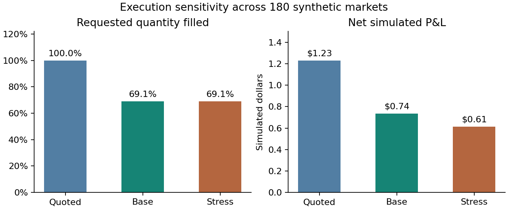

# Kalshi Crypto Prediction Market Bot

A Python project for 15-minute BTC, ETH, and XRP markets. The Kalshi Trade API collector retrieves resolved contracts for historical analysis. The offline simulator models trading signals, fills, fees, position sizing, and settlement.

Alex used the Kalshi API for real-money trading during development. This public release contains a rebuilt, read-only Kalshi client and a simulator. The original account-connected code and trading records were unavailable for this release.

## Run locally

Use Python 3.11 or newer. The project uses only the standard library.

```sh
python -m unittest discover -s tests -v
python scripts/run_demo_backtest.py --seed 7 --out-dir runs/demo
```

The offline demo writes trade-level output and a summary. Use a new output directory for each run. [Simulation methods](docs/methods.md) and [seed-7 metrics](docs/seed7_metrics.json) document the assumptions and the sample output.

## Collect Kalshi market data

This command makes public, read-only requests to the Kalshi Trade API. It requires no account or API keys.

```sh
python scripts/collect_kalshi.py --start 2026-11-13 --end 2026-11-20 --out-dir runs/kalshi-week
```

The collector follows pagination cursors, retries transient errors, and validates contract tickers, 15-minute durations, and binary resolution before aligning markets by UTC close time. It outputs normalized market records and a timestamped statistical summary. [API methods](docs/api.md)

## Historical Kalshi results

The November 13–20, 2026 UTC sample contains **1,992 finalized contracts** retrieved across **21 API pages**. The outcome and duration filters retained **664 of 672 possible windows per asset**.

| Pair | Matching YES/NO results | Shared windows | Agreement |
| --- | ---: | ---: | ---: |
| BTC / ETH | 567 | 664 | 85.4% |
| BTC / XRP | 528 | 664 | 79.5% |
| ETH / XRP | 535 | 664 | 80.6% |

[Saved API summary](docs/kalshi_week_summary.json)

## Held-out quote benchmark

Across 840 held-out contracts in 280 shared 15-minute windows, the five-minute Kalshi midpoint outperformed a quote-momentum adjustment. I used 1,152 earlier contracts to select the adjustment and froze it for the holdout.

| Metric | Kalshi midpoint | Quote-momentum adjustment |
| --- | ---: | ---: |
| Brier score (lower is better) | 0.12175 | 0.12733 |
| Log loss (lower is better) | 0.38486 | 0.40650 |
| Direction accuracy | 82.38% | 82.38% |

The adjustment increased Brier loss by 4.58% with no change in directional accuracy. The midpoint remains the stronger forecast in this sample. [Methods and reproduction](docs/evaluation.md) · [Recorded metrics](docs/kalshi_quote_evaluation.json)

## Execution simulation

On seed 7, the simulator generated 68 buy signals across 180 synthetic markets. Under the base execution assumptions, 55 signals filled at least partially and 69.1% of requested contract quantity filled.



The simulated fills and P&L use hypothetical prices, fees, and slippage. The public market analysis measures realized contract outcomes and provides no record of the bot’s own trades.
